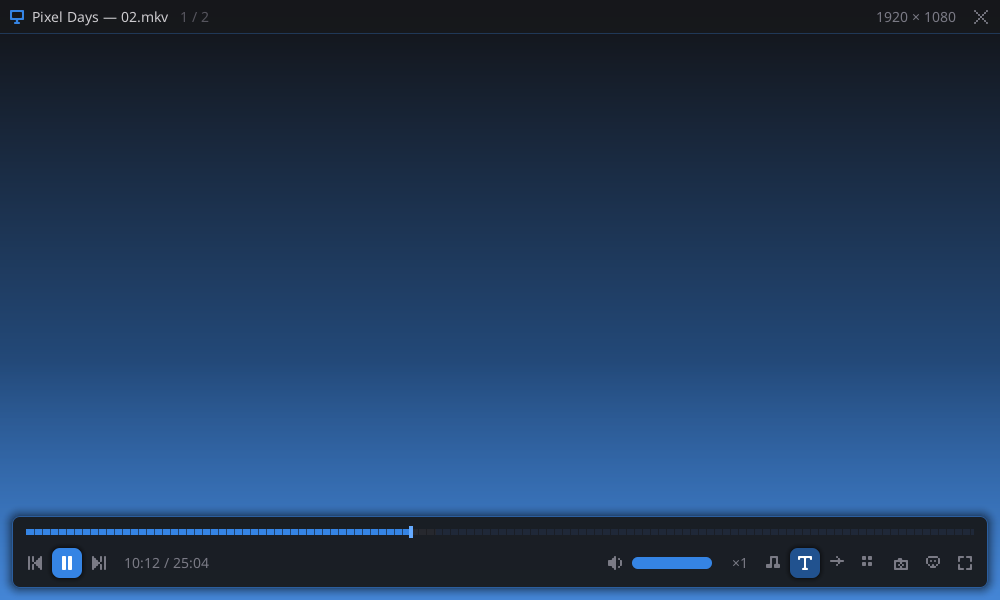
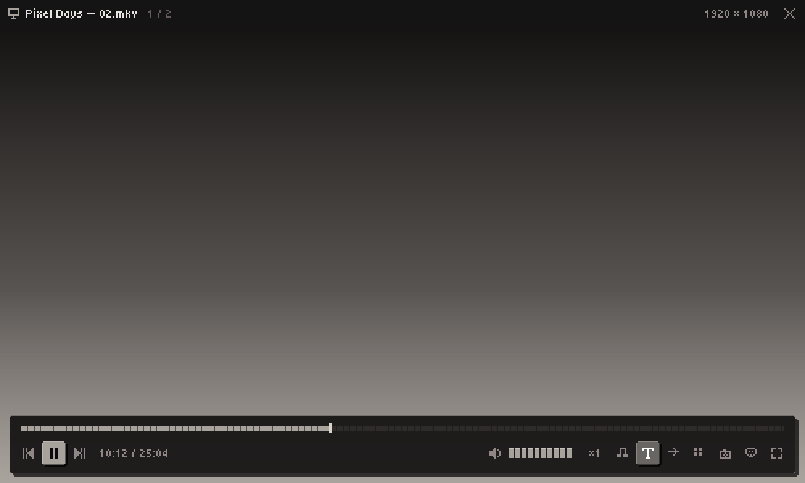

# yami-play

English · [Русский](README.ru.md)

A video and music player for Wayland: its own window and controls, and everything about formats
left to libmpv, loaded at start: every container and codec ffmpeg knows, hardware decoding,
subtitles, audio tracks, streams by URL. Part of the [yami](https://github.com/Trendorin/yami)
desktop, and works on its own on any Wayland compositor: no yami shell needed.

| neutral look (`plain`) | pixel look (`yami`) |
|---|---|
|  |  |

## What it does

- Plays a file, a folder (as a playlist in natural name order) or a URL; music gets its cover.
- Remembers where you stopped, with the audio and subtitle tracks (forgotten after a year unopened).
- Speed, frame stepping, loop, a sharp «pixel» scaling for pixel art and old games, a frame saved as
  PNG into Pictures.
- Keeps the screen awake while playing, hides the cursor, shows the letterbox in the theme's colour.

## Install

**One file** (x86_64, glibc 2.34 or newer) and libmpv from your distribution (`mpv` or `libmpv`):

```sh
curl -LO https://github.com/Trendorin/yami/releases/latest/download/yami-play
chmod +x yami-play
./yami-play install
```

No Rust and no root. `install` asks the language, the look and whether video and music should open
in it by default, lists what it will change and writes into `~/.local` only after your yes (`--yes`
takes the defaults, `--all` says yes to every question).

**From source** (Rust 1.89 or newer): `git clone https://github.com/Trendorin/yami-play`, then
`cargo build --release --locked` and `target/release/yami-play install`. libmpv is not needed to
build: it is opened at run time. The drawing library, yami-px, comes with the build from the
[yami](https://github.com/Trendorin/yami) repository.

It needs wayland, libxkbcommon and libmpv (`yami-play deps`); `yami-play uninstall` takes
everything back.

## Use

```sh
yami-play [FILE|FOLDER|URL…]
yami-play shot -o DIR       # the window as PNG without Wayland and without mpv
YAMI_PLAY_OPTS="hwdec=no,sub-font-size=40" yami-play film.mkv   # any mpv option
```

yami-play does not read mpv's own `mpv.conf`: `YAMI_PLAY_OPTS` takes `key=value` pairs separated
by commas.

| Keys | |
|---|---|
| Space or K, Enter or F | pause, full screen |
| ←, →, J | seek back and forward, 10 seconds back |
| ↑, ↓, M | volume, mute |
| PageUp, PageDown or P, N | previous and next in the folder |
| [, ], Backspace | slower, faster, normal speed |
| , and . | a frame back and forward |
| A, S, L | next audio track, next subtitles, loop the file |
| X, C, I, E | pixel scaling, save the frame, details, open its folder |
| Home, Esc or Q | from the start, close |

## Look and themes

Without any configuration it takes a neutral look: the system font, rounded corners, soft shadows,
light or dark as your system is set. Every part of it can be changed in two files, and the window
restyles itself the moment you save them:

| File | What |
|---|---|
| `~/.config/yami/style.json` | the look of every yami program: write a theme once, all of them take it |
| `~/.config/yami/style.play.json` | what yami-play does differently (only those keys) |

| Key | Values |
|---|---|
| `preset` | `plain` (neutral) or `yami` (pixel art: whole pixels, notched corners, the Tiny5 font inside the binary) |
| `palette`, `accent` | `blood`, `ash`, `sakura`, `amber`, `venom`, `ice`, `dusk`; or any `#rrggbb`: the rest of the palette is made from it |
| `light` | `true` or `false`; absent: as the system |
| `corners`, `radius` | `notch`, `round` or `square`; the radius in pixels |
| `shadow`, `bevel` | `hard`, `soft` or `none`; a raised edge on buttons |
| `reveal` | how panels appear: `fade`, `none`, `dither`, `scan`, `noise`, `wipe`, `blocks` |
| `font` | a font family |
| `animations`, `animSpeed` | on or off; their length (0.5 fast, 2 slow) |
| `colors` | any of `bg panel surface surfaceHi codeBg border dim accent deep glow bright selection text textDim textFaint onAccent textHi ok warn` |
| `lang` | `ru`, `en`, `pt-BR`; empty: as the system |

For example the controls in the pixel look and the theme's red: `{ "preset": "yami", "palette":
"blood" }`, or square and flat: `{ "preset": "plain", "corners": "square", "shadow": "none" }`.
Inside the yami desktop the shell writes `style.json` itself; `style.play.json` still wins.

## License

MIT
