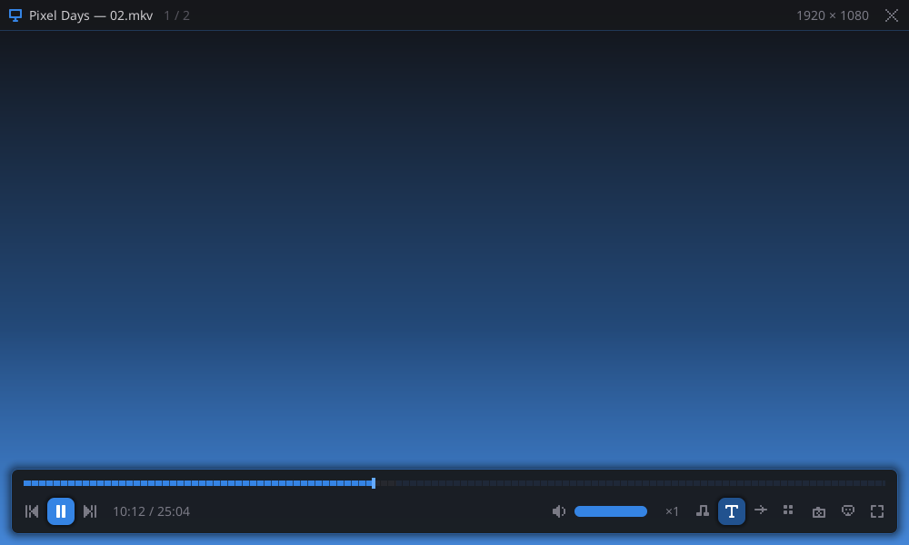
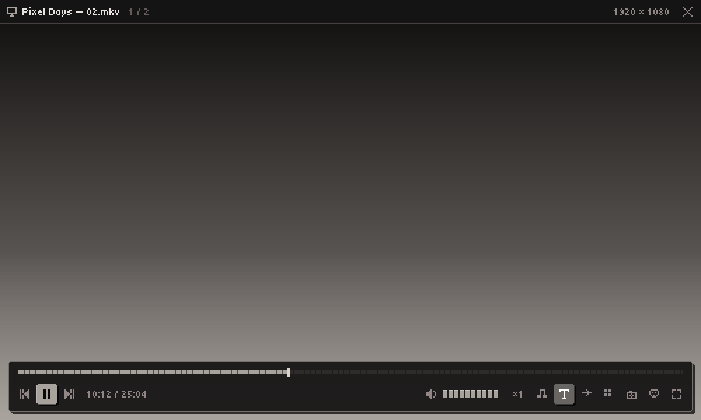

# yami-play

[English](README.md) · Русский

Плеер видео и музыки для Wayland: своё окно и управление, а всё, что касается форматов, отдано
libmpv, которая подгружается при запуске: любые контейнеры и кодеки, что знает ffmpeg, аппаратное
декодирование, субтитры, дорожки звука, потоки по ссылке. Часть рабочего стола
[yami](https://github.com/Trendorin/yami), которая работает и сама по себе в любом
Wayland-композиторе: шелл yami не нужен.

| нейтральный вид (`plain`) | пиксельный вид (`yami`) |
|---|---|
|  |  |

## Что умеет

- Играет файл, папку (как список в естественном порядке имён) или ссылку; у музыки — обложка.
- Помнит, где остановился, вместе с дорожками звука и субтитров (забывает, если год не открывали).
- Скорость, покадровый шаг, повтор, чёткий «пиксельный» масштаб для пиксель-арта и старых игр,
  кадр в PNG в «Изображения».
- Не даёт экрану погаснуть во время просмотра, прячет курсор, поля вокруг кадра — в цвет темы.

## Установка

**Один файл** (x86_64, glibc 2.34 или новее) и libmpv из твоего дистрибутива (`mpv` или `libmpv`):

```sh
curl -LO https://github.com/Trendorin/yami/releases/latest/download/yami-play
chmod +x yami-play
./yami-play install
```

Без Rust и root. `install` спросит язык, вид и открывать ли видео и музыку в нём по умолчанию,
покажет, что изменит, и запишет в `~/.local` только после твоего «да» (`--yes` берёт ответы по
умолчанию, `--all` отвечает «да» на всё).

**Из исходников** (Rust 1.89 или новее): `git clone https://github.com/Trendorin/yami-play`, затем
`cargo build --release --locked` и `target/release/yami-play install`. Для сборки libmpv не нужна:
она открывается при запуске. Библиотека рисования yami-px приходит при сборке из репозитория
[yami](https://github.com/Trendorin/yami).

Нужны wayland, libxkbcommon и libmpv (`yami-play deps`); `yami-play uninstall` убирает всё обратно.

## Как пользоваться

```sh
yami-play [ФАЙЛ|ПАПКА|URL…]
yami-play shot -o ПАПКА     # окно в PNG без Wayland и без mpv
YAMI_PLAY_OPTS="hwdec=no,sub-font-size=40" yami-play film.mkv   # любая опция mpv
```

Свой `mpv.conf` yami-play не читает: `YAMI_PLAY_OPTS` принимает пары `ключ=значение` через запятую.

| Клавиши | |
|---|---|
| Space или K, Enter или F | пауза, весь экран |
| ←, →, J | перемотка назад и вперёд, 10 секунд назад |
| ↑, ↓, M | громкость, без звука |
| PageUp, PageDown или P, N | предыдущий и следующий в папке |
| [, ], Backspace | медленнее, быстрее, обычная скорость |
| , и . | кадр назад и вперёд |
| A, S, L | следующая дорожка звука, следующие субтитры, повтор файла |
| X, C, I, E | пиксельный масштаб, сохранить кадр, сведения, открыть папку |
| Home, Esc или Q | с начала, закрыть |

## Вид и темы

Без настроек программа выглядит нейтрально: системный шрифт, скруглённые углы, мягкие тени,
светлая или тёмная тема как в системе. Любую часть меняют два файла, и окно перекрашивается в тот
же миг, как ты их сохранишь:

| Файл | Что |
|---|---|
| `~/.config/yami/style.json` | вид всех программ yami: тема пишется один раз, все её берут |
| `~/.config/yami/style.play.json` | чем yami-play отличается (только эти ключи) |

| Ключ | Значения |
|---|---|
| `preset` | `plain` (нейтральный) или `yami` (пиксель-арт: целые пиксели, углы с вырезом, шрифт Tiny5 внутри бинаря) |
| `palette`, `accent` | `blood`, `ash`, `sakura`, `amber`, `venom`, `ice`, `dusk`; или любой `#rrggbb`: остальная палитра строится от него |
| `light` | `true` или `false`; нет ключа — как в системе |
| `corners`, `radius` | `notch`, `round` или `square`; радиус в пикселях |
| `shadow`, `bevel` | `hard`, `soft` или `none`; выпуклый край у кнопок |
| `reveal` | как появляются панели: `fade`, `none`, `dither`, `scan`, `noise`, `wipe`, `blocks` |
| `font` | семейство шрифта |
| `animations`, `animSpeed` | вкл/выкл; их длительность (0.5 быстро, 2 медленно) |
| `colors` | любой из `bg panel surface surfaceHi codeBg border dim accent deep glow bright selection text textDim textFaint onAccent textHi ok warn` |
| `lang` | `ru`, `en`, `pt-BR`, `es`, `de`, `fr`, `uk`, `pl`; пусто — как в системе |

Например, управление в пиксельном виде и красном цвете темы: `{ "preset": "yami", "palette":
"blood" }`, или прямоугольное и плоское: `{ "preset": "plain", "corners": "square", "shadow": "none" }`.
В рабочем столе yami `style.json` пишет сам шелл; `style.play.json` всё равно главнее.

## Лицензия

MIT
